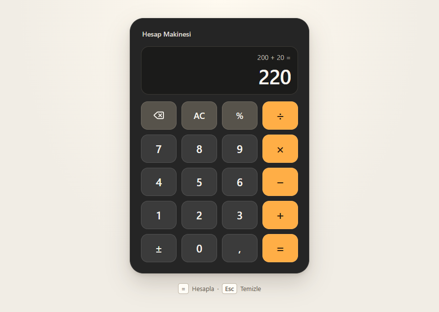
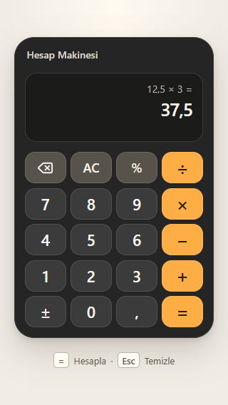

<p align="center">
  
</p>

<h1 align="center">Hesap Makinesi</h1>

<p align="center">
  macOS’tan esinlenen, fareyle, dokunarak ve klavyeyle kullanılabilen Türkçe bir web hesap makinesi.
</p>

<p align="center">
  <code>React</code> · <code>TypeScript</code> · <code>Vite</code>
</p>

<p align="center">
  <a href="#kurulum"><strong>Kurulum</strong></a> ·
  <a href="#klavye">Klavye</a> ·
  <a href="#geliştirme">Geliştirme</a>
</p>

<p align="center">
  
  
</p>

## Kurulum

Node.js 22.18 veya daha yeni bir 22.x sürümü ya da Node.js 24 ve üzeri gerekir.

```sh
npm ci
npm run dev
```

Uygulamayı açmak için terminalde gösterilen yerel adresi kullanın.

## Hesaplama örnekleri

| Tuş sırası | Sonuç | Davranış |
| :--- | ---: | :--- |
| `200 + 10 % =` | **220** | Toplama ve çıkarmada yüzde, ilk sayı üzerinden hesaplanır. |
| `12,5 × 3 =` | **37,5** | Ondalık sayılar virgülle gösterilir. |
| `8 + 2 = =` | **12** | İkinci `=` son işlemi tekrarlar. |
| `2 + 3 × 4 =` | **20** | Hesap makinesi işlemleri giriş sırasıyla uygular. |

Sayı girişinde en fazla 12 rakam kullanılabilir. Sonuçlar 12 anlamlı basamağa yuvarlanarak gösterilir.

## Klavye

| Tuş | İşlev |
| --- | --- |
| <kbd>0</kbd>–<kbd>9</kbd> | Sayı gir |
| <kbd>+</kbd> <kbd>-</kbd> <kbd>*</kbd> <kbd>/</kbd> | Dört işlem |
| <kbd>,</kbd> veya <kbd>.</kbd> | Ondalık ayırıcı |
| <kbd>%</kbd> | Yüzde |
| <kbd>=</kbd> veya <kbd>Enter</kbd> | Sonucu hesapla |
| <kbd>Backspace</kbd> | Son rakamı sil |
| <kbd>Esc</kbd> veya <kbd>Delete</kbd> | Tümünü temizle |
| <kbd>Tab</kbd> | Ekrandaki tuşlar arasında gezin |
| <kbd>Space</kbd> | Odaklanan tuşa bas |

Odak ekrandaki bir tuştayken <kbd>Enter</kbd> o tuşu etkinleştirir.

## Geliştirme

| Komut | İşlev |
| --- | --- |
| `npm run lint` | ESLint ile kaynak kodu denetle |
| `npm test` | Hesaplama testlerini çalıştır |
| `npm run build` | Üretim dosyalarını `dist/` klasörüne oluştur |
| `npm run preview` | Üretim derlemesini yerelde aç |

`dist/` klasörü statik barındırmaya hazırdır. GitHub Actions her push ve pull request’te lint, test ve derlemeyi çalıştırır. [İş akışı](./.github/workflows/ci.yml)

## GitHub'a yükleme

GitHub'da boş bir depo oluşturun. Aşağıdaki URL'de kullanıcı ve depo adını kendi bilgilerinizle değiştirin. [GitHub'ın yükleme kılavuzu](https://docs.github.com/en/migrations/importing-source-code/using-the-command-line-to-import-source-code/adding-locally-hosted-code-to-github)

```sh
git remote add origin https://github.com/KULLANICI_ADI/DEPO_ADI.git
git push -u origin main
```
